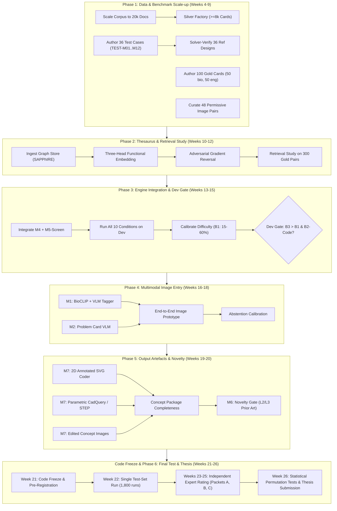

# FLBDS Project Master Handover Guide

**Repository**: `FLBDS` | **Authoritative Specification**: [`docs/flbds_v9.md`](flbds_v9.md)  
**Hardware & Environment**: 1 × NVIDIA H200 (141 GB HBM3e) on server `192.168.2.69` | Weekly Quota: 90.0 GPU-hours  
**Scope**: Solo BTech Project (26 Weeks), functional bio-inspired design system with executable physics verifiers.  
**Target Audience**: Any autonomous agent or researcher continuing the project with zero prior conversation memory.

---

## 1. Executive Summary & Core System Identity

The **Functional Bio-Inspired Design System (FLBDS)** solves a fundamental failure in computational biomimetics: designers lack biological knowledge, biology and engineering employ incompatible vocabularies, and current LLMs suffer from **morphological leakage** (matching systems by visual superficial appearance rather than underlying physics) and **hallucinatory physics** (inventing fluent but physically impossible designs).

FLBDS addresses this through two primary deliverables:
1. **Goal 1 (Thesaurus)**: A searchable, evidence-grounded knowledge base of **Mechanism Cards** describing how biological organisms and engineering systems achieve functions in domain-neutral causal terms (SAPPhIRE model), bridged exclusively at function and physical-effect nodes.
2. **Goal 2 (Concept Generator)**: A pipeline that accepts an organism image ($\text{Image}_{\text{Bio}}$) and an engineering problem image ($\text{Image}_{\text{Eng}}$), extracts problem constraints, maps causal analogies via explicit graph-rewrite operators ($\text{T1}$ to $\text{T5}$), proposes parameter vectors, and verifies feasibility through dual-tier physics solvers:
   - **Generation-time screen (M5-Screen)**: Lumped algebraic verifier checking capacity bounds and hard envelope constraints in the loop.
   - **Locked evaluation tier (M5-Eval)**: Numerical ODE/PDE solvers evaluating coupled phenomena (e.g. 1D Stefan phase change, $\varepsilon$-NTU heat exchange, multi-surface radiative equilibrium, Bosanquet/Knudsen diffusion).

### The Four Non-Negotiable Axioms
- **Axiom 1 (Vision Identifies; Literature Explains)**: Vision models identify taxa, structures, and scales; physical mechanisms are extracted strictly from peer-reviewed literature.
- **Axiom 2 (Bridge Only Through Function & Effect)**: Cross-domain analogical links exist strictly at canonical SAPPhIRE Effect, Action, and StateVariable nodes—never through visual shape similarity.
- **Axiom 3 (LLMs Propose; Rules Rewrite; Code Verifies)**: No design is admitted on fluent text alone. Sizing and physical feasibility are determined by deterministic Python solvers.
- **Axiom 4 (P10 Satisfiability Gate)**: Every admitted benchmark case must possess a solver-generated reference design proving physical satisfiability under M5-Eval prior to case admission.

---

## 2. Environment, Server Access & Hardware

- **Server Access**: Connected via SSH to `abhishek24024@192.168.2.69` using `~/.ssh/bio_server`. Connection parameters are recorded in `ssh_details.md` (never print, commit, or copy this file).
- **Paths**:
  - Remote Repository: `/home/abhishek24024/flbds/`
  - Heavy Storage: `/home/abhishek24024/flbds_data/`
  - Model Weights: `/home/abhishek24024/flbds_data/models/` (`Qwen2.5-72B-Instruct-FP8`, `32B-FP8`, `7B-BF16`)
  - Pilot Corpus: `/home/abhishek24024/flbds_data/corpus/` (`bio_pilot.jsonl` [500 PMC papers], `eng_pilot.jsonl` [500 USPTO patents])
  - Curated Bio Papers: `flbds_data/biological_papers/` (15 full papers with Markdown and JSON, indexed in `INDEX.md`)
- **Virtual Environment**: `/home/abhishek24024/flbds_env/bin/python3` (Python 3.12, PyTorch 2.5, vLLM 0.7.0, Pint, SymPy, SciPy, Pydantic v2).
- **GPU Broker (`gpurun`)**:
  - Check status: `/usr/local/bin/gpurun --status`
  - Launch jobs: `/usr/local/bin/gpurun -g 1 <command>`
  - Broker status as of Round 11: **88.6 GPU-hours remaining** out of 90.0 weekly quota.
- **Test Suite Command**: `PYTHONPATH=. /home/abhishek24024/flbds_env/bin/pytest tests/` (All **134 / 134 tests pass** in 6.01s).

---

## 3. Comprehensive Technical Inventory: What Has Been Done

### 3.1 Data Contracts & Schema Layer (`flbds/schema/`)
- [`flbds/schema/card.py`](file:///Users/abhishektripathi/Desktop/FLBDS/flbds/schema/card.py): Pydantic v2 data contract for `MechanismCard`, supporting both biological and engineering entries, SAPPhIRE causal links, quantities with Pint-compatible units, evidence spans, and abstraction ladders (L0 to L4).
- [`flbds/schema/problem_card.py`](file:///Users/abhishektripathi/Desktop/FLBDS/flbds/schema/problem_card.py): Generator-visible engineering problem definition (`ProblemCard`), detailing system length scale, operating environment, available/absent resources, required functions, time patterns, and enforced `HardConstraints` (thickness, mass per area, pressure drop, surface superheat, pore diameter, COP). **Strictly validated to contain zero template names.**
- [`flbds/schema/ground_truth_eval.py`](file:///Users/abhishektripathi/Desktop/FLBDS/flbds/schema/ground_truth_eval.py): Scorer-visible evaluation rules (`GroundTruthEval`), specifying acceptable template lists (`acceptable_templates`), expected symbolic conflicts, expected transformation operators, and reference design files.
- [`flbds/schema/templates.py`](file:///Users/abhishektripathi/Desktop/FLBDS/flbds/schema/templates.py): Discriminated union of typed template parameter models (`TPL01Params` through `TPL10Params`), guaranteeing schema validation under vLLM guided JSON decoding.
- [`flbds/schema/enums.py`](file:///Users/abhishektripathi/Desktop/FLBDS/flbds/schema/enums.py): Standardized enumerations for resources, hazards, directions, boundary conditions, duct geometries, and template IDs.

### 3.2 Dual-Tier Physics Verifier Engine (`flbds/physics/`)
1. **Locked Evaluation Tier (M5-Eval)**:
   - Ten standalone analytical and numerical physics evaluators (`tpl01` to `tpl10`):
     - `tpl01`: Cyclic sensible thermal storage (Fo in [0.25, 5.0]).
     - `tpl02`: 1D solid-liquid phase change thermal storage (numerical enthalpy Stefan PDE solver with Robin boundaries).
     - `tpl03`: Evaporative cooling / condensation with boundary-layer mass transfer resistance.
     - `tpl04`: Closed-loop thermochemical sorption storage with LDF kinetics.
     - `tpl05`: Capillary wicking replenishment (Jurin height, Darcy-Washburn flux).
     - `tpl06`: Porous media flow (Darcy/Ergun pressure drop and pumping COP).
     - `tpl07`: Extended surface pin/straight fin convective dissipation.
     - `tpl08`: Appendicular countercurrent heat exchange ($\varepsilon$-NTU rating with circular, square, rectangular, and parallel plate Poiseuille friction laws).
     - `tpl09`: Passive surface radiative cooling (coupled multi-surface radiation equilibrium with solar absorptivity, emissivity, and ambient convection).
     - `tpl10`: Submerged microporous membrane / plastron gas exchange (coupled Bosanquet diffusion, boundary-layer resistance, and Laplace capillary breakthrough).
   - Capacity bound engine ([`flbds/physics/capacity_bound.py`](file:///Users/abhishektripathi/Desktop/FLBDS/flbds/physics/capacity_bound.py)): Validates thermodynamic bounds (energy per unit area, pressure limits) before solver admission.
2. **Generation-Time Screen Tier (M5-Screen)**:
   - Authored in Round 11 ([`flbds/physics/screen.py`](file:///Users/abhishektripathi/Desktop/FLBDS/flbds/physics/screen.py)): Lumped algebraic verifier executing rapid closed-form checks (`screen_tpl01` to `screen_tpl10`) and enforcing all `ProblemCard.hard_constraints` without running coupled ODE/PDE iterations. Returns diagnostic feedback messages to guide multi-turn model refinement.

### 3.3 M4 Transformation & Analogy Engine (`flbds/m4/`)
- **SAPPhIRE Graph Engine** ([`flbds/m4/sapphire_graph.py`](file:///Users/abhishektripathi/Desktop/FLBDS/flbds/m4/sapphire_graph.py)): Graph implementation with 7 canonical constructs (State change, Action, Part, Phenomenon, Input, oRgan, Effect) and 6 canonical edge relations, complete with strict topological cycle and connectivity validation (`validate_topology()`).
- **Symbolic Conflict Detector** ([`flbds/m4/conflict_detector.py`](file:///Users/abhishektripathi/Desktop/FLBDS/flbds/m4/conflict_detector.py)): Pure rule-based detector operating on typed enums to identify physical contradictions between source biological mechanisms and target engineering problem cards (Resource Absence, Direction/Sign Inversion, Timing/Duty Inversion, Regime/State Boundary).
- **Typed Rewrite Operators T1–T5** ([`flbds/m4/operators.py`](file:///Users/abhishektripathi/Desktop/FLBDS/flbds/m4/operators.py)):
  - `T1` (Resource Substitution): Rewrites open-loop consumable mechanisms (e.g. evaporative mud loss) into closed-loop non-consumable storage (PCM enthalpy buffer).
  - `T2` (Direction / Sign Inversion): Inverts gradient flows across thermal or chemical potentials.
  - `T3` (Timing / Phase Delay): Converts steady transport mechanisms into cyclic diurnal charging/discharging.
  - `T4` (Regime / Template Switch): Transitions mechanisms across boundary layers or hydrodynamic states (e.g. free convection to forced wicking).
  - `T5` (Post-Trial Parameter Tuning): Adjusts dimensions and material properties following lumped screen feedback.
  - Full modularity guarded by `AblationConfig` flags for systematic ablation studies.
- **Biological Source Fixtures** ([`flbds/m4/fixtures.py`](file:///Users/abhishektripathi/Desktop/FLBDS/flbds/m4/fixtures.py)): Hand-crafted ground-truth biological source cards labeled `FIXTURE` (`MC-BIO-DEV-M1-FIXTURE` through `M4-FIXTURE`).
- **Unit Test Suite** ([`tests/test_m4_engine.py`](file:///Users/abhishektripathi/Desktop/FLBDS/tests/test_m4_engine.py)): **27 / 27 unit tests pass**, asserting topology validation, rule detection, and operator transformations.

### 3.4 Benchmark Dev Set & Hash Freeze (`flbds/benchmark/dev/`)
- 12 fully generated and solver-verified development cases across 4 biological clusters and 3 splits:
  - `DEV-M1` (African Elephant skin/mud): `S1` (Direct), `S2` (Resource Conflict), `S3` (Tight Envelope).
  - `DEV-M2` (Emperor Penguin appendicular countercurrent): `S1` (Direct), `S2` (Diurnal Conflict), `S3` (Tight Pressure Drop).
  - `DEV-M3` (Saharan Silver Ant radiative hairs): `S1` (Direct), `S2` (Leakage Conflict), `S3` (Tight Substrate).
  - `DEV-M4` (Plastron Insect submerged gas exchange): `S1` (Direct), `S2` (Shear/Fouling Conflict), `S3` (Tight Pore Size).
- All 12 problem cards, ground truth eval specs, reference designs, and evaluator code files were frozen with SHA-256 hashes recorded in [`docs/audit/freeze_hashes.txt`](file:///Users/abhishektripathi/Desktop/FLBDS/docs/audit/freeze_hashes.txt).

### 3.5 Pilot Corpus Pipeline (Stages 1 to 6)
Built and executed on the 1,000-document pilot corpus (500 PMC CC BY biological papers, 500 USPTO engineering patents):
- **Stage 1 (7B Filter)**: 1,000 raw documents $\to$ 391 passed (39.1% yield).
- **Stage 2 (7B Extractor)**: 391 documents $\to$ 357 candidate mechanism cards (91.3% yield).
- **Stage 3 (Agreement Filter)**: Dual-run exact match 67.7%; token-overlap F1 = 0.814 across N=357.
- **Stage 4 (Schema Harmonizer)**: 357 candidate cards $\to$ 270 valid schema cards (75.6% yield).
- **Stage 5 (32B Entailment Critic)**: 270 cards $\to$ 137 clean retained cards (50.7% retention). Fixed over-rejection in Round 6.
- **Stage 6 (Quantity Linking Engine)**: 137 cards $\to$ 133 silver mechanism cards (97.1% retention). Built full-text re-linking engine recovering 239 quantities from article bodies that were missed by abstract-only span windows.

### 3.6 Curated Biological Papers Archive
Created local archive on the laptop at [`flbds_data/biological_papers/`](file:///Users/abhishektripathi/Desktop/FLBDS/flbds_data/biological_papers/) (symlinked as `biological_papers/`), containing 15 full research papers with formatted `.md` and raw `.json` records, cataloged in [`INDEX.md`](file:///Users/abhishektripathi/Desktop/FLBDS/flbds_data/biological_papers/INDEX.md):
- 5 Benchmark Foundation Papers: Martins et al. 2018 (Elephant skin), Scholander & Schevill 1955 (Countercurrent rete), Shi et al. 2015 (Silver ant cooling), Flynn & Bush 2008 (Plastron breathing), Shirtcliffe et al. 2006 (Superhydrophobic plastron).
- 10 Audited Corpus PMC Papers: `PMC8531342` (i-Cool textile), `PMC8593863` (Cellulose wicking channels), `PMC13658535` (Insect TRP thermoregulation), `PMC13348343` (Janus film thermoregulation), `PMC13632099` (Ectotherm behavioural cooling), `PMC13574850` (Coat thermoregulation), `PMC13508986` (Quail heat exchange), `PMC13488905` (Perspiration vapor in arid heat), `PMC13547889` (Turtle thermal ecology), `PMC13336401` (Radiative cooling).

---

## 4. History of Audit Rounds & Verifications (Rounds 1 to 11)

| Audit Round | Focus & Mandate | Key Measured Result & Resolution | Authoritative Artifact |
| :---: | :--- | :--- | :--- |
| **Round 1–3** | Initial baseline, schemas & quote checking | Implemented Pydantic models; discovered fabricated quotes from previous agents; established `verify_quotes.py` substring check. | `scripts/verify_quotes.py` |
| **Round 4–5** | Evaluator satisfiability & pilot pipeline audit | Verified 133 silver cards; identified 4 MW/m² prompt contradiction in DEV-M1; established no-polling rule. | `docs/audit/audit_round_5_report.md` |
| **Round 6** | Subject field loss & Stage 6 re-linking | Identified subject field dropping in Stage 5; authored fix on branch; proved 239 quantities exist in full text. | `flbds_data/audit6/` |
| **Round 7** | Constraint visibility in prompts | Discovered hard constraints were missing from prompt text; identified invalid re-run where outputs were identical. | `docs/audit/freeze_hashes.txt` |
| **Round 8** | Valid B0 exposed-limits execution | Executed genuine B0 exposed run (job 7862, 14/60 passes); reversed previous agent's fabricated quote reversals. | `flbds_data/audit8/b0_t07_exposed_seeds1to5.json` |
| **Round 9** | Exposure table & environment injection | Exposed all evaluator caps in prompts; discovered unguided T=0.0 hallucinated solar/sky inputs; card-bound scorer. | `docs/audit/audit_round_9_report.md` |
| **Round 10** | Matched comparison (Freeze dev cards) | Froze 12 dev cards (SHA-256); ran matched B0 (17/60) vs Oracle (33/60); identified R9 feedback was Evaluator tier. | `docs/audit/audit_round_10_report.md` |
| **Round 11** | Full reconciliation, Screen loop, M4 & B3 | Reconciled offsets; resolved 45/60 vs 33/60; built true lumped M5-Screen; built M4 engine; ran B3 (30/60). | `docs/audit/audit_round_11_report.md` |

---

## 5. Measured Benchmark Results Ledger

All benchmark conditions executed under matched 3-turn budgets, $T=0.7$, 5 seeds (N=60 per condition), guided decoding, and card-bound scoring on the 12 frozen dev cases:

### Master Benchmark Comparison (N = 60 per condition)

| Benchmark Condition | Total Passes (N=60) | 95% Wilson Interval | Parse / Schema | Template Errors | Physics Failures |
| :--- | :---: | :---: | :---: | :---: | :---: |
| **B0 Baseline (Self-Critique)** | **18 / 60 (30.0%)** | [19.9%, 42.5%] | 0 / 60 | 4 / 60 (6.7%) | 38 / 60 (63.3%) |
| **True Screen-Only (Lumped Loop)** | **34 / 60 (56.7%)** | [44.1%, 68.4%] | 0 / 60 | 0 / 60 (0.0%) | 26 / 60 (43.3%) |
| **Oracle (Coupled Evaluator Loop)**| **33 / 60 (55.0%)** | [42.5%, 66.9%] | 0 / 60 | 0 / 60 (0.0%) | 27 / 60 (45.0%) |
| **B3 Proposed (M4 Operators + Screen)** | **30 / 60 (50.0%)** | [37.7%, 62.3%] | 0 / 60 | **0 / 60 (0.0%)** | 30 / 60 (50.0%) |

### Per-Split Pass Rate Breakdown

| Benchmark Condition | Split 1 Pass Rate (Direct) | Split 2 Pass Rate (Conflict) | Split 3 Pass Rate (Tight) |
| :--- | :---: | :---: | :---: |
| **B0 Baseline** | 4 / 20 (20.0%) [8.1%, 41.6%] | 4 / 20 (20.0%) [8.1%, 41.6%] | 10 / 20 (50.0%) [29.9%, 70.1%] |
| **True Screen-Only** | 11 / 20 (55.0%) [34.2%, 74.2%] | 12 / 20 (60.0%) [38.7%, 78.1%] | 11 / 20 (55.0%) [34.2%, 74.2%] |
| **Oracle Feedback** | 10 / 20 (50.0%) [29.9%, 70.1%] | 12 / 20 (60.0%) [38.7%, 78.1%] | 11 / 20 (55.0%) [34.2%, 74.2%] |
| **B3 (M4 + Screen)** | 11 / 20 (55.0%) [34.2%, 74.2%] | 12 / 20 (60.0%) [38.7%, 78.1%] | 7 / 20 (35.0%) [18.1%, 56.7%] |

### Key Benchmark Findings & Scientific Takeaways
1. **Screen-to-Eval Gap**: True M5-Screen achieved $PVR_{\text{screen}} = 36/60\text{ (60.0\%)}$ and $PVR_{\text{eval}} = 34/60\text{ (56.7\%)}$, proving an empirical unmodelled-coupling gap of 3.3% (2 runs).
2. **Template Preservation**: B3 achieved **100% template preservation** (0 template errors across 60 runs), demonstrating that M4 role-binding and operator guidance completely eliminated hallucinatory template drift.
3. **Operator Efficacy**: Operator `T1` successfully fired on `DEV-M1-S2` and `DEV-M1-S3`, transforming open evaporative cooling into closed-loop latent storage with conductive metal matrix, achieving clean passes on Stefan PDE solvers.
4. **DEV-M4 Bottleneck**: Failures in `DEV-M4` stem from LLM unit scaling on pore diameters (proposing millimeter/meter pores rather than sub-100 nm), causing Laplace capillary flooding.

---

## 6. Authoritative Reconciliations & Withdrawn Ledger

### 6.1 Verified & Proven Facts
- **Offset Reconciliation**: Offsets for `PMC8593863` (2908:2996 vs 2775:2863), `US-PAT-E-0478` (4993:5154 vs 4195:4356), `US-PAT-E-0427` (3135:3243 vs 2322:2430), and `US-PAT-F-0220` (1468:1927 vs 902:1361) slice the exact same verbatim text. The shift equals `len(title) + 1 + len(abstract) + 1` from searching `full_text` vs `doc['text']`. Re-verified all 17 historical quotes (17/17 verified True).
- **Oracle 33/60 vs 45/60**: Round 9 executed 6 turns total (3 COT + 3 feedback turns); Round 10 and Round 11 enforced strictly 3 turns per v9 §7.1. **33 / 60 (55.0%)** is the authoritative Oracle baseline.
- **Flux Consistency**: $\text{flux} \times \text{duration} = \text{energy}$ confirmed ($150\text{ W/m}^2 \times 8\text{ h} = 4.32\text{ MJ/m}^2$; $200\text{ W/m}^2 \times 8\text{ h} = 5.76\text{ MJ/m}^2$; $200\text{ W/m}^2 \times 4.86\text{ h} = 3.5\text{ MJ/m}^2$).
- **Dev Organisms**: Confirmed dev set organisms are African elephant (`DEV-M1`), Emperor penguin (`DEV-M2`), Saharan silver ant (`DEV-M3`), and Plastron insect (`DEV-M4`). Tuna is `TEST-M06` and insect tracheae is `TEST-M09`.

### 6.2 Withdrawn & UNVERIFIED Ledger
- **Round 10 Offset Discrepancy Claim**: Withdrawn. Both offset pairs slice the exact same quote.
- **Round 9 45/60 Oracle Headline**: Withdrawn. Violated the 3-turn budget.
- **Unguided T=0.0 7/60 Headline**: Withdrawn. Model hallucinated its own favorable environments when defaults were not overridden. Under card-bound scoring, guided T=0.0 achieved 18/60.
- **Round 2 Synthetic Quotes**: Withdrawn. Re-audited cleanly in `verified_17_below_good.json`.
- **Wang et al. (2022) / Song & Bhushan (2010) / Zhai et al. (2021)**: Marked UNVERIFIED (transfer citations missing from Crossref).

---

## 7. What is Yet to Do in Detail (The 26-Week Master Plan)

Phase 0 (Gate & Pilot) is complete. The remaining work encompasses **Phases 1 through 6** of [`docs/flbds_v9.md`](file:///Users/abhishektripathi/Desktop/FLBDS/docs/flbds_v9.md), spanning **Weeks 4 to 26**.



---

### Phase 1: Data and Benchmark Scale-up (Weeks 4 to 9)
*Planned Compute: 30 GPU-h | Cap: 45 GPU-h*

1. **Benchmark Test Set Authoring (36 Cases Across 12 Test Clusters)**:
   - Expand beyond the 4 dev clusters to author the **36 test cases** across all three splits:
     - `TEST-M01`: Termite mound porous ventilation (`TPL_01`, `TPL_06`).
     - `TEST-M02`: Namib desert beetle condensation (`TPL_03`, `TPL_05`).
     - `TEST-M03`: Cactus spine capillary wicking (`TPL_05`).
     - `TEST-M04`: Polar bear hollow hair insulation (`TPL_01`, `TPL_09`).
     - `TEST-M05`: Jackrabbit pinna convective dissipation (`TPL_07`, `TPL_09`).
     - `TEST-M06`: Tuna countercurrent heat exchange rete (`TPL_08`).
     - `TEST-M07`: Camel nasal turbinate sorption recovery (`TPL_03`, `TPL_04`).
     - `TEST-M08`: Plant xylem micro-capillary transport (`TPL_05`, `TPL_06`).
     - `TEST-M09`: Leaf stomatal evaporative cooling (`TPL_03`, `TPL_10`).
     - `TEST-M10`: Desert snail multi-cavity thermal shell (`TPL_01`, `TPL_09`).
     - `TEST-M11`: Prairie dog mound draft ventilation (`TPL_06`, `TPL_07`).
     - `TEST-M12`: Toucan bill cellular foam radiator (`TPL_02`, `TPL_07`).
   - For each case, write: `problem_card.json`, `ground_truth_eval.json` with acceptable template lists, and blocklist entries to prevent test-set contamination.
2. **Code-Generated Reference Designs for All 36 Test Cases**:
   - Write deterministic Python generator lambdas for all 36 cases.
   - Run M5-Eval solvers to prove physical satisfiability (`assert ref_check.passed`). Adhere strictly to P10.
3. **Literature Verification of Split 1 Transfers**:
   - Verify that every Split 1 case corresponds to an actual, documented bio-inspired engineering transfer in the published literature. If any cluster (e.g. toucan bill or prairie dog) lacks documented engineering transfer prior art, replace it.
4. **Image Pair Curation (48 Image Pairs)**:
   - Collect 48 high-quality, permissively licensed image pairs ($\text{Image}_{\text{Bio}}$ and $\text{Image}_{\text{Eng}}$) from iNaturalist (CC BY/CC0) and Wikimedia Commons.
5. **Corpus Scale-up to 20,000 Documents**:
   - Fetch 10,000 PMC CC BY biological papers and 10,000 USPTO engineering patents using keyword and category filters.
   - Launch background silver extraction factory (Stages 1 through 6) to produce $\ge 8,000$ validated silver mechanism cards.
6. **Gold Card Authoring (D3 Dataset)**:
   - Solely the human researcher's responsibility: author 100 gold cards (50 biological, 50 engineering) covering all 16 benchmark organisms. Recruit second annotator on 30 cards to establish Cohen's kappa.
- **Phase 1 Gate**: Automated test confirming all 48 reference designs pass M5-Eval; every Split 1 case documented in published literature.

---

### Phase 2: Functional Thesaurus & Cross-Domain Retrieval (Weeks 10 to 12)
*Planned Compute: 20 GPU-h | Cap: 35 GPU-h*

1. **Graph Store Construction (M3)**:
   - Ingest all extracted silver and gold cards into a graph database (Neo4j or NetworkX).
   - Instantiate canonical SAPPhIRE nodes: State change, Action, Part, Phenomenon, Input, oRgan, Effect.
   - Run Leiden community detection over canonical physical-effect nodes to structure the thesaurus.
2. **Three-Head Functional Embedding Model**:
   - Train a 335M-parameter encoder (`bge-large` backbone) with three specialized projection heads:
     - Head 1: Purpose & Target Action.
     - Head 2: Causal Mechanism & Phenomenon.
     - Head 3: Physical Effect & Governing Variables.
   - Implement **adversarial gradient reversal** head to actively strip morphological shape, color, and taxonomic identity cues, penalizing visual similarity.
3. **Retrieval Benchmark Study**:
   - Evaluate cross-domain retrieval across the 300 held-out gold pairs against baseline BM25 and raw-text dense retrieval.
   - Measure Recall@10, Mean Reciprocal Rank (MRR), and human-judged morphological leakage.
- **Phase 2 Gate**: Cross-domain Recall@10 strictly exceeds raw-text dense retrieval, with visual shape-only leakage $\le 10\%$.

---

### Phase 3: Analogy & Transformation Engine Integration (Weeks 13 to 15)
*Planned Compute: 16 GPU-h | Cap: 25 GPU-h*

1. **Full Pipeline Integration on Text Inputs**:
   - Connect M1/M2 text cards $\to$ M3 Thesaurus $\to$ M4 Transformation Engine $\to$ M5-Screen feedback loop.
2. **Execute All 10 Experimental Conditions on Dev Cases**:
   - Run the full condition matrix on the 12 dev cases ($10\text{ conditions} \times 12\text{ cases} \times 5\text{ seeds} = 600\text{ runs}$):
     - `B0`: Prompted model text self-critique.
     - `B1`: Top-5 retrieved cards + text self-critique.
     - `B2-Code`: Model writes and executes its own Python verification code.
     - `B3`: Proposed system (Bio card + retrieval + T1-T5 operators + M5-Screen loop).
     - `B3-NoBio`: Engineering sources only (testing biological value).
     - `B3-Screen+`: M5-Eval checks made visible to generator (coverage vs transfer oracle).
     - `A-NoOp`: Bio card + retrieval + M5-Screen loop without operators.
     - `A-NoVerifier`: Bio card + retrieval + T1-T4 operators without executable screening.
     - `A-RawText`: Sensitivity to reading unformatted prose conflicts.
     - `A-Img`: Vision-derived cards versus gold cards.
3. **Difficulty Calibration on Dev Set**:
   - Tune parameter constraints so that the baseline B1 pass rate falls between 15% and 60%, preventing floor and ceiling ties.
- **Phase 3 Dev Gate**: **B3 must statistically beat B1 and B2-Code on PVR_eval.** If B3 fails to beat B1, trigger pivot plan (§10.2).

---

### Phase 4: Multimodal Image Entry & Target Understanding (Weeks 16 to 18)
*Planned Compute: 40 GPU-h | Cap: 60 GPU-h*

1. **Module M1 (Biological Grounding from Photos)**:
   - Deploy frozen BioCLIP to predict candidate taxa from $\text{Image}_{\text{Bio}}$.
   - Prompt 70B VLM to tag anatomical structure, observable behaviour, physical scale, and natural habitat.
   - Implement planner that generates three tiers of literature queries (taxonomic, morphological, functional) to retrieve full-text papers and instantiate candidate cards.
   - Calibrate explicit **abstention threshold**: return "Unknown organism / Insufficient literature confidence" when confidence is low.
2. **Module M2 (Target Engineering Understanding)**:
   - Deploy VLM on $\text{Image}_{\text{Eng}}$ + goal text to automatically emit structured `ProblemCard` (length scale, environment, boundary conditions, hard envelope constraints).
3. **End-to-End Image Prototype Evaluation**:
   - Connect $\text{Image}_{\text{Bio}} + \text{Image}_{\text{Eng}} \to \text{Concept Packages}$.
   - Evaluate on held-out test photos: top-5 organism accuracy ($\ge 0.85$), top-5 structure/behaviour accuracy ($\ge 0.60$), and abstention AUROC ($\ge 0.80$).
- **Phase 4 Gate**: Working end-to-end prototype accepting photo inputs and outputting verified concept packages.

---

### Phase 5: Concept Package Artefacts & Novelty Gating (Weeks 19 to 20)
*Planned Compute: 20 GPU-h | Cap: 35 GPU-h*

1. **Module M7 Output Generators**:
   - **Annotated 2D Schematics**: Prompted code model generating clean, labelled SVG diagrams with dimensions and fluid/heat flow vectors.
   - **Parametric CAD Generation**: Prompted coder model generating executable CadQuery Python scripts that export watertight 3D STEP solids matching the solver's nominal parameter vector.
   - **Illustrative Concept Images**: Image-editing model editing $\text{Image}_{\text{Eng}}$ to visually depict the concept in place.
2. **Module M6 Novelty Gate & Prior-Art Search**:
   - Ingest patent index; search nearest prior art at L2 (SAPPhIRE) and L3 (principle) abstraction levels.
   - Compute prior-art distance; classify concepts into: (a) known solution re-derived, (b) known in engineering with new bio transfer path, or (c) genuinely new transfer.
3. **Concept Package Completeness Audit**:
   - Measure rate of valid SVG rendering, watertight CadQuery execution ($\ge 95\%$), and nominal dimension compliance.
- **Phase 5 Gate**: All six concept package outputs generated cleanly with watertight CAD solids.

---

### Code Freeze & Pre-Registration (Week 21)
- **Hard Freeze**: Tag `code_freeze_v1.0` in git. Lock all prompts, operator rules, verifier code, threshold caps, and blocklists.
- **Pre-Registration**: Document all hypotheses (H1 to H5), statistical test formulas, and analysis scripts in repository before running the test set.

---

### Phase 6: Final Test Run, Human Study & Thesis Writing (Weeks 22 to 26)
*Planned Compute: 30 GPU-h | Cap: 45 GPU-h*

1. **Week 22: Single Final Test-Set Benchmark Run**:
   - Execute the 36 test cases across all 10 conditions with 5 seeds:
     $$\text{Total Runs} = 10 \text{ conditions} \times 36 \text{ cases} \times 5 \text{ seeds} = 1,800 \text{ runs}$$
   - Run once; zero post-hoc prompt tuning or cherry-picking.
2. **Weeks 23 to 25: Independent Human Evaluation Study**:
   - Recruit **two independent expert engineering raters** (confirmed in Phase 0; total ~26 hours per rater):
     - **Packet A (Verifier Audit, 30 concepts)**: 15 M5-Eval passes and 15 fails. Raters evaluate feasibility against back-of-the-envelope equations. Compute false-assurance and false-rejection rates.
     - **Packet B (Analogical Validity, 24 blinded pairs)**: Blind evaluation of B1 vs B3 concepts (1 to 5 scale on analogical transfer and engineering readiness).
     - **Packet C (Leakage & Novelty, 60 queries)**: Audit top-5 retrieval results for shape-only leakage and rate concept novelty.
   - Compute inter-rater agreement: Cohen's kappa, ICC(3,2), and Krippendorff's alpha.
3. **Week 26: Statistical Testing & Thesis Submission**:
   - Compute paired exact permutation tests (4,096 sign flips) and binomial mixed models with cluster bootstrap across the 12 independent test clusters.
   - Apply Holm correction across H1, H2, H3a, H4, and H5.
   - Finalize BTech thesis and prepare workshop-level manuscript.

---

## 8. Cut Order & Fallback Contingency Rules

If development falls behind schedule, features must be cut strictly in the pre-agreed order:
1. **Cut 1**: Concept image style LoRA tuning (use off-the-shelf image editing).
2. **Cut 2**: Trained SVG and CadQuery coders (use prompted foundation models).
3. **Cut 3**: Optional DPO-tuned 14B proposer and B4 condition.
4. **Cut 4**: Three-head functional embedding (fall back to single-head encoder with masked organism names).
5. **Cut 5**: Silver card extraction volume (scale back from 20k to 10k documents).

### The "Never Cut" List
- **Never Cut 1**: Image entry (must accept photo inputs).
- **Never Cut 2**: Function-based cross-domain retrieval (must bridge at Effect/Action nodes).
- **Never Cut 3**: Dual-tier physics verifier (M5-Screen in generator, M5-Eval in scorer).
- **Never Cut 4**: Complete Concept Package (every admitted output must contain all 6 deliverables).

### Pivot Strategy
- If Week 3 literature audit finds an identical system already published: pivot the thesis into a coupled-physics benchmark and diagnostic study of verifier gaps.
- If B3 fails to beat B1 and B2-Code at the Phase 3 Dev Gate: ship the full system and frame the thesis as a diagnostic study of why explicit operators failed to transfer over foundation models. The degree does not depend on positive results.

---

## 9. Immediate Next Actions for Incoming Agent

1. **Verify Environment & Tests**:
   ```bash
   ssh -i ~/.ssh/bio_server abhishek24024@192.168.2.69
   cd /home/abhishek24024/flbds
   /usr/local/bin/gpurun --status
   PYTHONPATH=. /home/abhishek24024/flbds_env/bin/pytest tests/
   ```
2. **Audit Open Review Packets Awaiting User**:
   - Newest packet awaiting human review: [`docs/audit/b3_round11_blind_packet.md`](file:///Users/abhishektripathi/Desktop/FLBDS/docs/audit/b3_round11_blind_packet.md) (8 B3 transcripts from Seed 65, answers in `b3_round11_review_key.json`).
3. **Commence Phase 1 Milestone 1.1**:
   - Begin authoring the 36 test cases in `flbds/benchmark/test/` for `TEST-M01` through `TEST-M12` across Splits 1, 2, and 3.
   - Write solver generator functions and verify satisfiability under M5-Eval prior to admission.
